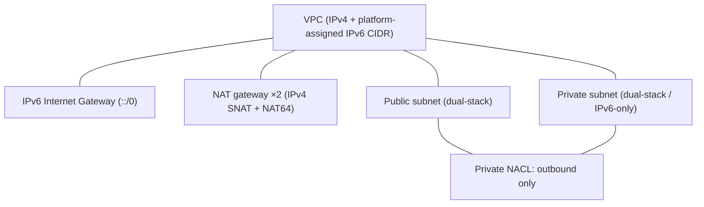

# distributed-x-infrastructure-ipv6-network


> A reference practice for building a VPC that carries both IPv4 and IPv6 on Huawei Cloud, plus an IPv6-native network for IPv6-only workloads.

## 1. Overview

### Introduction

This practice provides two pure network infrastructure Terraform templates to help users quickly build IPv6 networks on Huawei Cloud:

- **Dual-stack VPC** (`infra/`): public and private subnets carry both IPv4 and IPv6.
- **IPv6-native VPC** (`infra-ipv6-native/`): private subnets target IPv6-only workloads, with DNS64 enabled and access to the IPv4 Internet via NAT64.

It is suitable for teams that need to deploy IPv6 dual-stack or IPv6-first architectures on Huawei Cloud, and for engineers who want to understand the Huawei Cloud IPv6 network model.

---

## 2. Table of Contents

- [1. Overview](#1-overview)
- [2. Table of Contents](#2-table-of-contents)
- [3. Architecture Diagram](#3-architecture-diagram)
- [4. Highlights](#4-highlights)
- [5. Cloud Services Used](#5-cloud-services-used)
- [6. Prerequisites](#6-prerequisites)
- [7. Quick Start](#7-quick-start)
- [8. Step-by-Step Deployment](#8-step-by-step-deployment)
- [9. Usage / Verification](#9-usage--verification)
- [10. Cleanup](#10-cleanup)
- [11. Detailed Explanation](#11-detailed-explanation)
- [12. Dependencies](#12-dependencies)
- [13. FAQ / Troubleshooting](#13-faq--troubleshooting)
- [14. Contributing](#14-contributing)
- [15. License](#15-license)
- [16. Contact / Maintainers](#16-contact--maintainers)

---

## 3. Architecture Diagram



---

## 4. Highlights

- **Dual-form coverage**: provides both dual-stack and IPv6-native templates.
- **Verify and go**: `terraform validate` has passed, and deployment commands are reproducible with one click.

---

## 5. Cloud Services Used

| Service | Purpose | Notes |
|---|---|---|
| VPC | Dual-stack / IPv6-native network address space | IPv6 CIDR automatically assigned by the platform |
| Subnet | Public / private dual-stack; IPv6-only private subnet | `ipv6_enable=true` |
| IPv6 Internet Gateway | VPC-level IPv6 egress | `add_route=true` writes the default route automatically |
| NAT gateway + EIP | IPv4 egress and NAT64 | Used by the IPv6-native variant |
| NACL | Public: allow all / Private: outbound only | Controls inbound and outbound traffic |

> **Tip**: All services can be created with one command via this repository's Terraform; for cleanup, see [Section 10 "Cleanup"](#10-cleanup).

---

## 6. Prerequisites

- A Huawei Cloud account with VPC / NAT / EIP / IPv6 gateway permissions.
- IPv6 is enabled in the target region (e.g., `cn-north-4`).
- Terraform >= 1.5, huaweicloud provider `1.96.0`.
- Credentials are provided via environment variables: `HW_ACCESS_KEY` / `HW_SECRET_KEY` (temporary credentials use `HW_SECURITY_TOKEN`).

---

## 7. Quick Start

```bash
# Dual-stack VPC
cd infra
terraform init && terraform validate && terraform apply

# IPv6-native VPC (optional)
cd ../infra-ipv6-native
terraform init && terraform validate && terraform apply
```

---

## 8. Step-by-Step Deployment

1. Set credential environment variables.
2. `cd infra` (or `infra-ipv6-native`).
3. `terraform init` initializes the provider.
4. `terraform validate` validates the configuration (expected `Success!`).
5. `terraform plan` previews resources.
6. `terraform apply` creates resources.

---

## 9. Usage / Verification

### Usage and verification

```bash
terraform output # View VPC / subnet / NAT / IGW IDs
terraform state list # Check resources
```

Console check: the VPC has an IPv6 CIDR assigned; the default route table contains `0.0.0.0/0 → NAT` and `::/0 → IPv6 Internet Gateway` (IPv6-native additionally contains `64:ff9b::/96 → NAT`); NACLs are associated with subnets.

Connectivity (after launching an ECS in the VPC): a private ECS can `ping`/`ping6` public addresses; for IPv6-native, a private ECS `ping6` to an IPv4-only domain should work via DNS64+NAT64.

After deployment, follow these steps to verify that the business functionality works before considering the delivery complete.

---

## 10. Cleanup

```bash
terraform destroy
# After destruction, check via console API that EIP / NAT / subnet / VPC have no leftovers
```

---

## 11. Detailed Explanation

- Architecture and design decisions: [`docs/architecture.md`](docs/architecture.md).
- Deployment and runtime switches (DNS64 / NAT64 / `add_route`): [`docs/deployment-guide.md`](docs/deployment-guide.md).
- Key simplification: Huawei Cloud provides only one route table per VPC by default; public/private routes are consolidated into the default table.

---

## 12. Dependencies

### Dependencies and references

- Huawei Cloud Terraform Provider (huaweicloud).

---

## 13. FAQ / Troubleshooting

### FAQ

**Q: Huawei Cloud subnets must contain an IPv4 CIDR; how can IPv6-only be achieved?**
A: The subnet still carries an IPv4 CIDR, but the business uses only IPv6 addresses, with NAT64 providing access to the IPv4 Internet (see architecture-adaptation.md §2.7).

**Q: The default table lacks a `::/0` route after apply?**
A: `add_route` behavior differs across some regions/versions; you can manually add a `::/0` route for the IPv6 Internet Gateway in the console.

---

## 14. Contributing

Please submit feedback and improvement suggestions via Issues; this repository does not accept direct PRs, and all changes are merged after maintainer review.

---

## 15. License

This practice uses the **MIT No Attribution** license; see [`LICENSE`](LICENSE) in the repository root.

This practice is released under the [MIT-0](LICENSE) license.

---

## 16. Contact / Maintainers
| Item | Content |
|---|---|
| **Creator** | [dgc-git](https://github.com/dgc-git) |
| **Maintainer** | [dgc-git](https://github.com/dgc-git) |
| **Contact** | GitHub Issues / PR (see [Section 14](#14-contributing)) |
