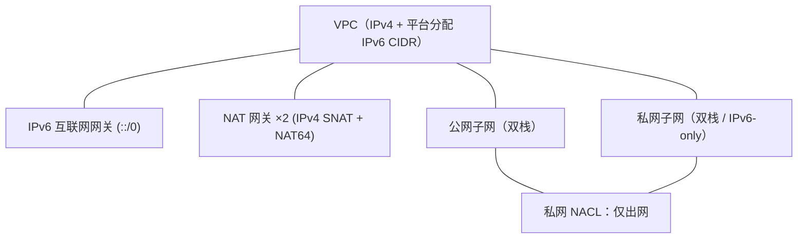

# distributed-x-infrastructure-ipv6-network · 华为云 IPv6 双栈 / IPv6-native VPC 实践


> 在华为云上构建同时承载 IPv4 与 IPv6 的 VPC，以及面向 IPv6-only 工作负载的 IPv6-native 网络的参考实践。

## 1. 简介 / Overview

### 简介


本实践提供两套纯网络基础设施的 Terraform 模板，帮助用户在华为云快速搭建 IPv6 网络：

- **双栈 VPC**（`infra/`）：公网 / 私网子网同时承载 IPv4 与 IPv6。
- **IPv6-native VPC**（`infra-ipv6-native/`）：私网子网面向 IPv6-only 工作负载，启用 DNS64 并经 NAT64 访问 IPv4 互联网。

适用于需要在华为云落地 IPv6 双栈或 IPv6 优先架构的团队，以及希望理解华为云 IPv6 网络模型的工程师。

---

## 2. 目录

- [1. 简介 / Overview](#1-简介--overview)
- [2. 目录](#2-目录)
- [3. 架构图](#3-架构图)
- [4. 方案亮点](#4-方案亮点)
- [5. 涉及云服务](#5-涉及云服务)
- [6. 前置条件](#6-前置条件)
- [7. 快速开始](#7-快速开始)
- [8. 分步部署](#8-分步部署)
- [9. 使用方法 / 验证](#9-使用方法--验证)
- [10. 清理资源](#10-清理资源)
- [11. 详细说明](#11-详细说明)
- [12. 依赖](#12-依赖)
- [13. FAQ / 故障排除](#13-faq--故障排除)
- [14. 贡献指南](#14-贡献指南)
- [15. 许可证](#15-许可证)
- [16. 联系方式 / 维护者](#16-联系方式--维护者)

---

## 3. 架构图



---

## 4. 方案亮点

- **双形态覆盖**：同时提供双栈与 IPv6-native 两套模板。
- **即验即走**：`terraform validate` 已通过，部署命令一键可复现。

---

## 5. 涉及云服务

| 服务 | 用途 | 备注 |
|---|---|---|
| VPC | 双栈 / IPv6-native 网络地址空间 | 平台自动分配 IPv6 CIDR |
| 子网 | 公网 / 私网双栈；IPv6-only 私网 | ipv6_enable=true |
| IPv6 互联网网关 | VPC 级 IPv6 出口 | add_route=true 自动写默认路由 |
| NAT 网关 + EIP | IPv4 出口与 NAT64 | ipv6-native 变体使用 |
| NACL | 公网全放通 / 私网仅出网 | 控制入站与出网流量 |

> **提示**：所有服务均可通过本仓库的 Terraform 一键创建；如需清理，请参见 [第 10 节「清理资源」](#10-清理资源)。

---

## 6. 前置条件

- 华为云账号具备 VPC / NAT / EIP / IPv6 网关权限。
- 目标区域已开通 IPv6（如 `cn-north-4`）。
- Terraform >= 1.5，huaweicloud provider `1.96.0`。
- 凭据经环境变量提供：`HW_ACCESS_KEY` / `HW_SECRET_KEY`（临时凭证 `HW_SECURITY_TOKEN`）。

---

## 7. 快速开始

```bash
# 双栈 VPC
cd infra
terraform init && terraform validate && terraform apply

# IPv6-native VPC（可选）
cd ../infra-ipv6-native
terraform init && terraform validate && terraform apply
```

---

## 8. 分步部署

1. 设置凭据环境变量。
2. `cd infra`（或 `infra-ipv6-native`）。
3. `terraform init` 初始化 provider。
4. `terraform validate` 校验配置（预期 `Success!`）。
5. `terraform plan` 预览资源。
6. `terraform apply` 创建资源。

---

## 9. 使用方法 / 验证

### 使用方法与验证


```bash
terraform output # 查看 VPC / 子网 / NAT / IGW ID
terraform state list # 核对资源
```

控制台核对：VPC 已分配 IPv6 CIDR；默认路由表含 `0.0.0.0/0 → NAT` 与 `::/0 → IPv6 互联网网关`（IPv6-native 额外含 `64:ff9b::/96 → NAT`）；NACL 已关联子网。

连通性（VPC 内发射 ECS 后）：私网 ECS `ping`/`ping6` 公网地址应通；IPv6-native 私网 ECS `ping6` 仅 IPv4 域名应经 DNS64+NAT64 通。

部署完成后请按本节步骤自行验证，确认业务功能可用，方可视为交付完成。

---

## 10. 清理资源

```bash
terraform destroy
# 销毁后建议控制台 API 直查 EIP / NAT / 子网 / VPC 无残留
```

---

## 11. 详细说明

- 架构与设计决策见 [`docs/architecture.md`](docs/architecture.md)。
- 部署与运行期开关（DNS64 / NAT64 / `add_route`）见 [`docs/deployment-guide.md`](docs/deployment-guide.md)。
- 关键收敛：华为云每 VPC 默认仅 1 张路由表，公网/私网路由已收敛到默认表。

---

## 12. 依赖

### 依赖与参考


- 华为云 Terraform Provider（huaweicloud）。

---

## 13. FAQ / 故障排除

### FAQ


**Q：华为云子网必须含 IPv4 CIDR，如何实现 IPv6-only？**
A：子网仍携带 IPv4 CIDR，但业务上仅使用 IPv6 地址，配合 NAT64 访问 IPv4 互联网（详见 architecture-adaptation.md §2.7）。

**Q：apply 后默认表缺 `::/0` 路由？**
A：部分区域/版本 `add_route` 行为有差异，可在控制台为 IPv6 互联网网关手动补一条 `::/0` 路由。

---

## 14. 贡献指南

请通过 Issue 提交反馈与改进建议；本仓库不接受直接 PR，统一由维护者评审后合入。

---

## 15. 许可证

本实践采用 **MIT No Attribution** 许可证，详见仓库根目录 [`LICENSE`](LICENSE) 文件。


本实践采用 [MIT-0](LICENSE) 许可证发布。

---

## 16. 联系方式 / 维护者
| 项 | 内容 |
|---|---|
| **创建者** | [dgc-git](https://github.com/dgc-git) |
| **维护者** | [dgc-git](https://github.com/dgc-git) |
| **联系方式** | GitHub Issues / PR（见[第 14 节](#14-贡献指南)） |
