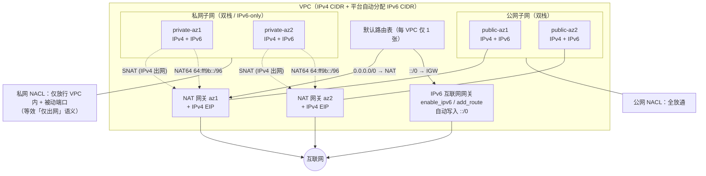

# 华为云 IPv6 双栈 / IPv6-native VPC 实践架构

> 本文档说明本最佳实践在华为云上的网络架构，帮助读者理解如何在华为云上构建同时承载 IPv4 与 IPv6 的 VPC，以及面向 IPv6-only 工作负载的 IPv6-native 网络。

## 1. 架构总览

本实践提供两套模板（均为纯网络基础设施，不含应用代码）：

- **双栈 VPC（`infra/`）**：公网 / 私网子网同时承载 IPv4 与 IPv6，公网实例可绑定 IPv4/IPv6 EIP 入站，私网子网经 NAT 出网。
- **IPv6-native VPC（`infra-ipv6-native/`）**：私网子网面向 IPv6-only 工作负载（启用 IPv6 + DNS64），并通过 NAT64 访问 IPv4 互联网。

## 2. 关键设计点

| 设计点 | 华为云实现 | 说明 |
|--------|-----------|------|
| 双栈启用 | 子网 `ipv6_enable = true` | 平台自动为 VPC 分配 IPv6 CIDR，并为每个子网分配 `/64`，无需（也无法）在 VPC 层声明 |
| IPv6 出网 | `huaweicloud_vpc_internet_gateway`（`enable_ipv6` + `add_route`） | `add_route=true` 在默认路由表自动写入 `::/0` 出口 |
| IPv4 私网出网 | NAT 网关 + IPv4 EIP + SNAT 规则 | `0.0.0.0/0 → nat` 写入默认路由表 |
| 仅出网（无主动入站） | 私网 NACL 拒绝非受邀入站 | 等效「仅出网」语义（拒绝非受邀入站） |
| IPv6-only 访问 IPv4 | NAT64 路由 `64:ff9b::/96 → nat` | 需在 NAT 网关开启 NAT64 能力（控制台/API） |
| 路由收敛 | 全部子网共用默认路由表 | 华为云每 VPC 默认仅 1 张路由表（见 `architecture-adaptation.md`） |

## 3. 两种变体的差异

| 维度 | 双栈（`infra/`） | IPv6-native（`infra-ipv6-native/`） |
|------|----------------|--------------------------------------|
| 私网子网 | 双栈，IPv4/IPv6 均使用 | 以 IPv6 为主，启用 DNS64，经 NAT64 访问 IPv4 |
| 额外路由 | 仅 `0.0.0.0/0 → nat` | 额外 `64:ff9b::/96 → nat`（NAT64） |
| 适用场景 | 通用双栈业务 | IPv6-only 微服务 / 合规驱动的 IPv6 优先架构 |

## 4. 区域与配额

- 默认区域 `cn-north-4`，可在 `variables.tf` 修改。
- 每 VPC 默认仅 1 张路由表；如需为不同子网设置不同路由策略，请在华为云控制台申请提升路由表配额，再新建 `huaweicloud_vpc_route_table` 并关联子网。
- IPv6 互联网网关、NAT64 等能力请以目标区域实际支持情况为准。
